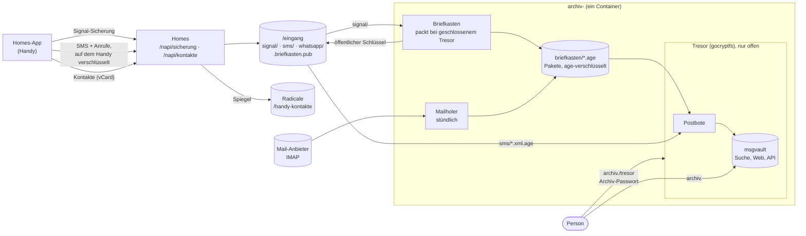

# archiv

Das Nachrichten-Archiv je Person — for the household on a Laib box
([laib ADR 0029](https://github.com/mdopp/laib/blob/main/docs/adr/0029-one-message-archive-per-person.md),
laib#985, laib#986). One container per person: a small Go supervisor keeps
the person's [msgvault](https://github.com/wesm/msgvault) archive in a
gocryptfs vault that only their password opens, and closes it after two
idle hours. Signal backups, the phone's SMS and calls (from the Homes app)
and mail (IMAP, every hour) reach it even while the vault is closed: they
wait encrypted in the person's Briefkasten or inbox, which only the open
vault can read. The newest Signal backup stays on the box for a new phone
(`/eingang/letzte/`).

What is readable where: the inbox's Signal and WhatsApp files are
encrypted by the messenger, the SMS files by the Homes app, the packets by
age to the Briefkasten; the private key and msgvault's database live only
in the vault. The keys that let the box read while the vault is closed (the
Signal passphrase, the IMAP app password) lie outside it, and the page says
so. Contacts are mirrored outside the vault, in Radicale, like the calendar.

Made in the Werkstatt (`laib-app new archiv`).

- `apps/archiv/` — the program, its tests, its `Containerfile` and
  `integration.sh`; its [README](apps/archiv/README.md) says what it does,
  what is proven and what is not, and **what the Laib template must give**.
- The Laib template is `templates/archiv` in the
  [laib repo](https://github.com/mdopp/laib/tree/main/templates/archiv),
  installed once per person (laib#986).
- CI (`.github/workflows/apps.yml`): `go vet` + `go test`, then the image
  is built and `integration.sh` runs it with a real FUSE mount, real
  signalbackup-tools and real msgvault; on main the image is published as
  `ghcr.io/mdopp/archiv:latest` and `:<sha>`, only after both are green.

## The template's contract, in short

| | |
|---|---|
| env | `ARCHIV_PERSON` (the person's login, required), `PROXY_SECRET` (the route's proxySecret; Caddy sends it as `X-Archiv-Proxy`), `ARCHIV_HOMES_SECRET` (Homes' `/intern/…`), `TZ`; optional `PUBLIC_URL`, `LEERLAUF` (seconds, default 7200) |
| mounts | `/data` ← `${DATA_DIR}/archiv/<person>` (`tresor/`, `briefkasten/`, `schluessel/`, `gesehen/`, `briefkasten.pub`, `laib-status.json`, `archiv-stand.json`, `aufgaben.json`); `/eingang` ← `${DATA_DIR}/archiv-eingang/<person>` (read, write, delete) |
| backup | `${DATA_DIR}/archiv-eingang/<person>/letzte` is `backup: false` (a phone backup itself, GBs that change nightly) |
| FUSE | `AddDevice=/dev/fuse`, `AddCapability=SYS_ADMIN`; the supervisor runs as the container's root |
| port | `8080` in the container (publish on `127.0.0.1` only, `lan: false`) |
| health | `GET /healthz` → `ok`, in every state |
| status | `/data/laib-status.json` |
| route | browser: Authelia, then the person's instance with the proxy secret and `Remote-User`; agents: `/p/<person>/` stripped, past Authelia, `Authorization: Bearer <msgvault key>` |

Details, what is proven on the box and what is not, are in
[apps/archiv/README.md](apps/archiv/README.md).
